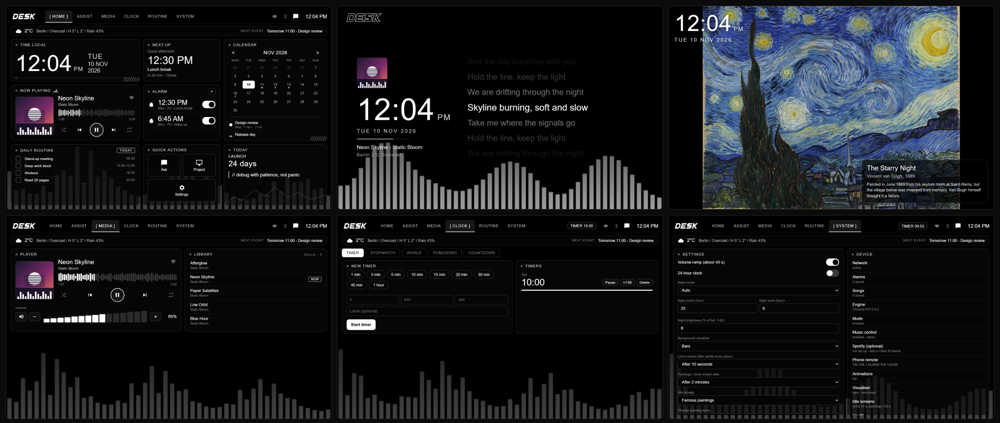

# Desk Display

**A black-and-white smart desk display for an old Android tablet, in the spirit of a smart-speaker screen.**
Clock, alarms with a volume ramp, timers, weather, a calendar with events, a music player with a live
visualiser and synced lyrics, famous paintings as an idle screen, night mode, and a phone remote.
It runs as a kiosk app: the tablet boots straight into it. No cloud account, no Gradle, no dependencies.

[Download the APK](../../releases/latest) · [Install](#install-apk) · [Build from source](#build-from-source) · [Spotify (optional)](#music-and-spotify-optional)



> The screenshots were rendered with neutral demo data (a made-up track and sample alarms) in a desktop browser at the tablet's
> resolution (1920x1200). They show the real UI that ships in the app.

## Features

| | |
|---|---|
| **Home** | Clock, next alarm, calendar, now playing, daily routine, quick actions, weather and next-event strip |
| **Alarms** | Repeat days, volume ramp, built-in tones, your own songs, optional Spotify song (Premium), snooze |
| **Media** | Player with scrubbing, queue, volume. Shows whatever the tablet is playing (Spotify, YouTube Music, ...) |
| **Clock** | Timers, stopwatch, world clocks, Pomodoro, countdowns |
| **Routine** | Daily tasks and calendar events; tap any date to see its events |
| **Assist** | Type commands such as "set an alarm at 6:45 pm", "pause", "next" |
| **Idle screens** | Synced lyrics after 10 s while music plays, 16 famous paintings (with the painter and a bit of trivia) or a big clock after 2 min |
| **Night mode** | Automatic dim, black screen with a quiet clock |
| **Phone remote** | Control it from a phone browser or the small Desk Remote app, protected by a PIN |
| **Updates over Wi-Fi** | Push a new page or paintings from your PC without a cable, with automatic rollback |

Idle-screen timings, fonts (terminal or Helvetica style), animation level, weather place and units are all in SYSTEM.

More screenshots are in [`docs/screenshots`](docs/screenshots).

## What you need

* An Android tablet or phone, Android 5.0 or newer, used in landscape (built and tested on a 10.1" 1920x1200 tablet).
* Wi-Fi (weather, lyrics and the optional Spotify link need internet; the clock, alarms and timers do not).
* To **install**: just the APK. To **build**: Windows with PowerShell, a JDK (8 or newer) and the Android SDK
  (`build-tools` and one `platforms/android-NN`). No Gradle.

## Install (APK)

1. Download `desk-display-1.0.0.apk` from the releases, copy it to the tablet and open it
   (allow "install unknown apps" for your file manager when asked).
2. Press **Home** and choose **Desk Display** as the Home app, "Always". It now starts on boot and returns after a crash.
3. Tap **ARM DISPLAY** once (in the kiosk app it arms itself).
4. Allow what it asks for:
   * **Notification access** (Settings > Apps > Special access) so it can read and control the music player.
     SYSTEM shows "Music control: enabled" when this is on.
   * **Microphone** permission. This is only for the live audio spectrum of the visualiser. Nothing is recorded or stored.
5. Turn off battery optimisation for the app if your tablet kills background apps.
6. In SYSTEM, set your weather place (or leave it blank to detect it from your IP) and the idle-screen timings.

Android may say the app is from an unknown developer: the APK is signed with a throwaway key made on the machine that built it.

## Build from source

```powershell
cd kiosk
.\build.ps1                    # -> kiosk\out\desk-display.apk
adb install -r out\desk-display.apk
```

* The script finds the SDK from `ANDROID_HOME` (or `ANDROID_SDK_ROOT`, or `%LOCALAPPDATA%\Android\Sdk`).
* On the first build it creates `kiosk\debug.keystore`. **Keep that file** if you want later builds to update the same install.
* The page (`index.html`), `remote\remote.html` and `art\*.jpg` are packed into the APK as assets.

The phone remote app is built the same way from `phone\` (`phone\out\desk-remote.apk`).

## Update over Wi-Fi (no cable)

Page changes (anything in `index.html`, `remote\remote.html`, `art\`) do not need a rebuild:

```powershell
.\tablet.ps1 setup -Ip 192.168.1.50 -Pin 123456   # address and PIN are shown in SYSTEM > Device > Phone remote
.\tablet.ps1 push                                 # sends changed files and reloads the tablet
.\tablet.ps1 backup                               # saves alarms, routine, events and settings to a JSON file
.\tablet.ps1 restore -File backup.json
.\tablet.ps1 reset                                # drop pushed files and go back to the page built into the app
```

If a pushed page does not start, the tablet goes back to the built-in page by itself after about 45 seconds.
Java changes (`kiosk\src`) still need a rebuilt APK.

## Phone remote

* In a browser: open `http://<tablet-ip>:8080/remote` and enter the PIN from SYSTEM > Device.
* Or install **Desk Remote** (`phone\`), which finds the tablet on your Wi-Fi.
* The PIN protects every control call. Wrong guesses are rate-limited; "New PIN" in SYSTEM changes it.

## Music, and Spotify (optional)

The player reads the **Android media session**, so now playing, the queue, play/pause/next, seeking, the visualiser and synced
lyrics work with **any music app**, including a free Spotify account. No setup needed beyond Notification access.

Spotify itself is an optional extra, because Spotify only allows remote control through its Web API:

| | Free account | Premium |
|---|---|---|
| Now playing, lyrics, visualiser, play / pause / next / seek | yes (through the Android player) | yes |
| Choose a Spotify song or playlist for an alarm | no | yes |
| Press play on the display and it starts your last song | no | yes |

To use the Premium features you bring your own Client ID (it is free to create, and nothing is shared with anyone else):

1. Create an app at <https://developer.spotify.com/dashboard>. Add the redirect URI `http://127.0.0.1:8080/spotify/callback`.
2. In SYSTEM, paste the **Client ID** into the Spotify box, then press **Connect Spotify**.
3. Approve the permissions in the browser. Tablets with an old Chrome (the login page needs a modern one) can do the login
   from a PC instead: use `adb forward tcp:8080 tcp:8080`, open the same login URL on the PC, and approve there.

If an alarm song cannot start (no Premium, offline, Spotify closed), the built-in chime plays as a backup so the alarm still rings.

## Privacy

Everything you create (alarms, events, settings) stays on the tablet. The page contacts only:
[Open-Meteo](https://open-meteo.com) (weather and place search), [ipwho.is](https://ipwho.is) (guess your city when you leave
the place blank), [LRCLIB](https://lrclib.net) (synced lyrics for the song that is playing, by title and artist) and the Spotify API
(only if you connect it). The phone remote and updates run on your own network.

## Project layout

```
index.html        the whole tablet UI (single page, plain JavaScript, no dependencies)
remote/           the phone remote page
art/              the 16 paintings (public domain, see art/CREDITS.md)
kiosk/            Android app: WebView kiosk, music-session bridge, local server, Spotify client
phone/            Desk Remote Android app
tablet.ps1        update / back up the tablet over Wi-Fi
hardware/stand/   3D-printable stand (OpenSCAD source and STL) for a 10.1" tablet
docs/screenshots/ screenshots of every panel
```

Customising: the wordmark is the vector `#i-logo` symbol in `index.html`; the paintings and their captions are the `ART` list;
colours are the CSS variables at the top of the file.

## Known limits

* Spotify may ignore "play this song" commands sent to an idle tablet; the app works around it by launching Spotify and pressing play
  on its restored session. Alarm songs from Spotify can therefore fall back to the chime.
* The UI targets a landscape tablet. It runs in an old WebView (Chrome 77), so the page avoids newer CSS and JavaScript features.

## License

MIT, see [LICENSE](LICENSE). Painting images are public domain (see [art/CREDITS.md](art/CREDITS.md)).
